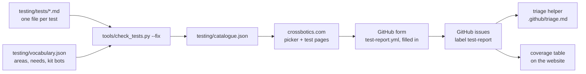

# The test list: help us test the library

This library is new. We test it on our robots and in the simulator, but your robot is different. This
folder is a list of small tests. Each one says what to do, what counts as a pass, and what to write
down. Teams pick the tests that fit their robot, run them, and send the result with a GitHub form.

**For teams:** pick a test on the website, https://crossbotics.com/ftc-helper/testing/. It shows only
the tests that fit your robot. Each test page has a **Report result** button.

**For the people who look after the library:** this page. How the parts fit:

## How testing works (the short version)

1. **Pick** a test that fits your robot (the website's picker, or the files in [tests/](tests)).
2. **Prepare:** read the whole test once. Do the Setup list. Simulator first when the test allows it.
3. **Run** the numbered steps. Safety notes come first.
4. **Report** with the [Test report form](https://github.com/crossbotics/ftc-helper-lib/issues/new?template=test-report.yml):
   pass or fail, the numbers the Record list asks for, and what you changed for your robot.

A fail is as useful as a pass. No student names in reports.

## Add a test

1. Copy a test file that is close to yours, for example [tests/SET-01.md](tests/SET-01.md). Name the copy
   with its ID: 2-5 capital letters for the area, a dash, 2 digits (`AIM-05.md`). Use the next free number.
2. Change the header (between the `---` lines):

   | Field | What to write |
   | --- | --- |
   | `id` | the same as the file name, `AIM-05` |
   | `title` | what is tested, in a few words (80 characters at most) |
   | `area` | one of the areas in [vocabulary.json](vocabulary.json) (`aim`, `shooter`, ...) |
   | `priority` | `high`, `medium` or `low`: how much we need it |
   | `where` | `sim`, `real` or `both` |
   | `minutes` | about how long it takes, a whole number |
   | `needs` | what the robot must have, from `needs` in vocabulary.json: `[flywheel, limelight\|webcam]` (each item is needed; `\|` = either one). `[any]` for any robot |
   | `kit_bots` | the starter bots that have everything in `needs`: `[gobilda, rev]`, or `[]` |
   | `since` | the first release it works with, `v0.16.0`, or `unreleased` |
   | `docs` | the docs pages it tests, from `docs/`: `[guides/finders.md#hood-finder]` |

3. Write the sections, each a `## ` heading, in this order:
   - `## Why`: why we need this tested, in 2-3 sentences.
   - `## Safety`: a list (needed when it runs on a real robot): glasses, block, hard stops, low power.
   - `## Setup`: a list of what must be ready before step 1.
   - `## Steps`: one numbered list. One action per step. Real button names and Driver Station words.
   - `## Pass rule`: one sentence with numbers (how far, how fast, how many out of how many).
   - `## Record`: a list of the numbers and facts to write down. The report form copies this list.
   - `## If your robot is different`: what the test is really checking, and how to adapt it.
     Most robots are not ours, and not a starter bot.
4. Run `python3 tools/check_tests.py --fix`. It checks the file and writes `catalogue.json` (the
   website reads that). Fix what it says, then commit both.

Plain, short English: a high-school student with little Java must be able to follow it alone.

## Add a word to `needs`

A new kind of part (say, a "wrist") needs three changes together, or the check fails:

1. `vocabulary.json`: the word, its label, and the form field and option it matches.
2. `.github/ISSUE_TEMPLATE/test-report.yml`: the option in that field (usually the `robot_has` checkboxes).
3. The website's picker reads vocabulary.json from the catalogue: nothing to change there.

## At a release

`python3 tools/check_tests.py --set-since v0.17.0` changes every `since: unreleased` to the new version
and writes the catalogue. The website takes the catalogue from the newest release tag, like the docs.

## Triage and labels

New issues get a first look from an AI helper that follows [.github/triage.md](../.github/triage.md).
It needs the labels made by [tools/make_labels.sh](../tools/make_labels.sh) and the repository secret
`ANTHROPIC_API_KEY`; without the secret it does nothing.
